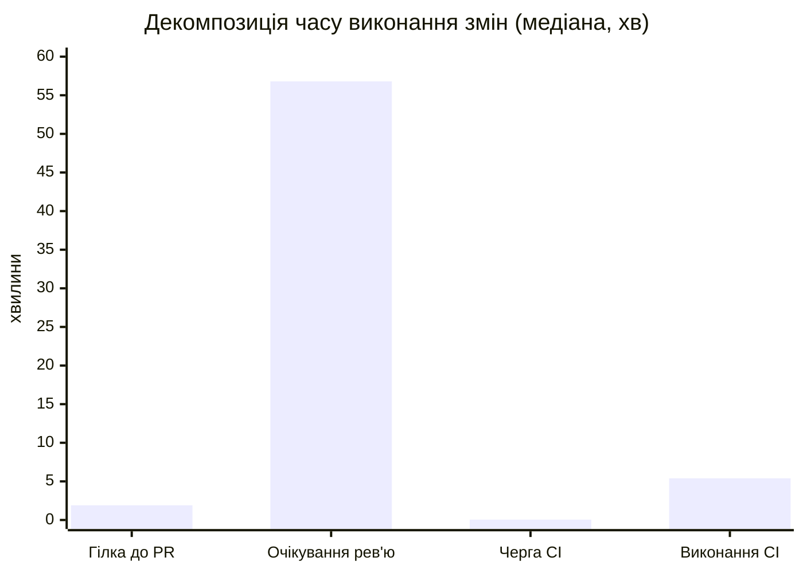
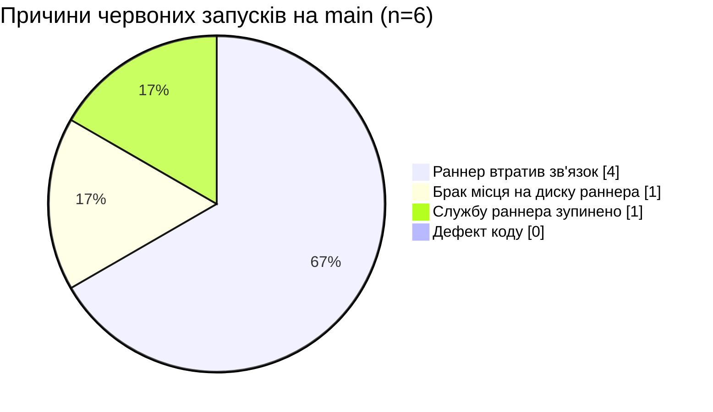
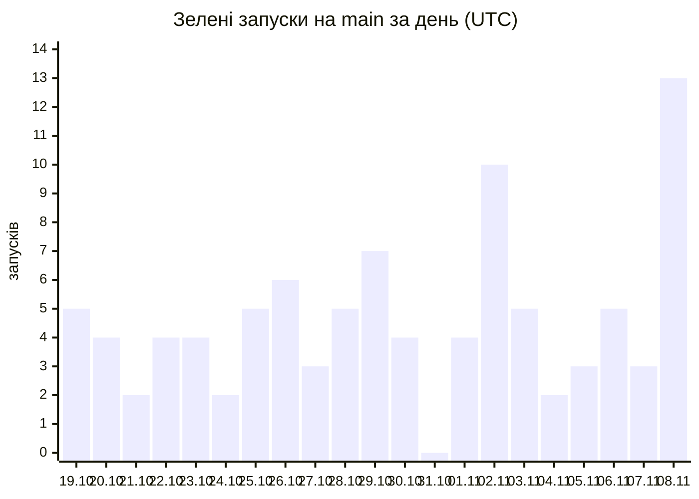

# Лабораторна 10 — Етапи 2–4: метрики DORA, першопричини, план покращень

**Репозиторій:** `ukma-fin-ssdm-2026/SSDM_12` · **Вікно:** 19.10–09.11.2026 (21 день = 3 тижні)
**Сирі дані:** [`metrics-raw.md`](metrics-raw.md) — 104 запуски `CI` на `main`

---

## 0. Що в цій лабораторній вважаємо розгортанням

| Рішення | Обґрунтування |
|---|---|
| **Одиниця розгортання = завершений запуск workflow `CI` на `main`** | `CI` — єдиний конвеєр, що проходить кожна зміна; він же обов'язкова перевірка PR. Усі 104 коміти у вікні прийшли зі змерджених PR, прямих пушів немає, тож «запуск на `main`» = «одна прийнята зміна» |
| **Зелений запуск = успішне розгортання** | — |
| **Червоний запуск = невдале розгортання** | — |
| **Скасовані (2) виключено з обох частин дробу** | Скасування — рішення людини (№18 скасував @dysett) або обрив раннера, а не відмова зміни. Для прозорості нижче наведено й варіант із ними |

> ⚠️ **Це наближення.** У визначенні DORA йдеться про розгортання **в робоче середовище**.
> У нас: `Release` (теги + GitHub Release) спрацював у вікні **4 рази**, а `render.yaml` описує
> *необов'язкове публічне демо*. Тобто «розгортання в прод» ≠ «зелений CI на main». Усі числа нижче —
> **проксі з телеметрії CI**, а не з продакшну; у цьому вони порівнянні з орієнтирами CircleCI,
> але з рівнями DORA — лише приблизно.

---

## 1. Етап 2: чотири метрики DORA

| Метрика | Формула | Наш результат | Рівень → частка опитаних DORA 2025 з таким або кращим результатом |
|---|---|---|---|
| **Частота розгортань** | 96 зелених / 3 тижні | **32,0 / тиждень** (4,6 / день) | **на вимогу (кілька разів на день)** → **16,2 %** |
| **Час виконання змін** | перший коміт PR → завершення зеленого запуску на `main` | **середнє 5,3 год** (315 хв) · **медіана 1,3 год** (80 хв) | **менше доби** → **24,4 %** |
| **Частота збоїв змін** | 6 червоних / 102 завершених | **5,9 %** | **4–8 %** → **36,2 %** |
| **Час відновлення** | червоний запуск → наступний зелений на `main` | **середнє 5,3 год** (316 хв) · **медіана 2,1 год** (124 хв) | **менше доби** → **56,5 %** |

**Чутливість результатів до припущень** (що питатимуть на захисті):

| Варіант підрахунку | Частота збоїв |
|---|---|
| Червоні / (зелені + червоні) — **основний** | 6/102 = **5,9 %** |
| Червоні / усі завершені, зі скасованими | 6/104 = 5,8 % |
| Тільки **дефекти коду** (інфраструктурні збої виключено) | 0/102 = **0 %** — див. §3 |

Розподіл часу виконання змін за кошиками DORA: **< 1 год — 37 (39 %)**,
< 1 доби — 57 (59 %), від доби до тижня — 2 (2 %), понад тиждень — 0.
Середнє (5,3 год) у 4 рази більше за медіану (1,3 год) — його тягне хвіст: PR #264 має 131 год,
бо перший коміт зроблено за 126 год до відкриття PR (довгоживуча гілка), а не через конвеєр.

---

## 2. Орієнтири з телеметрії CI (CircleCI, State of Software Delivery 2025–2026)

| Показник | Рекомендований орієнтир | Фактичне значення у даних 2025 | **Наше значення** | Вердикт |
|---|---|---|---|---|
| Частка успішних запусків на основній гілці | 90 % | 70,8 % | **94,1 %** | ✅ вище орієнтиру |
| Повернення основної гілки до зеленого | до 60 хв | 59,2 хв (медіана) | **124 хв (медіана)**, середнє 316 хв | ❌ удвічі гірше за орієнтир |
| Тривалість запуску workflow | до 10 хв | 2,2 хв (медіана) | **5,4 хв (медіана)**, p90 = 10,0 хв, max = 24,8 хв | ⚠️ у межах орієнтиру, але p90 на самій межі; 9 запусків його перетнули |

### Черга проти виконання

| Складова (зелені запуски) | Середнє, хв | Медіана, хв | p90, хв | Max, хв | Частка середнього часу виконання змін |
|---|--:|--:|--:|--:|--:|
| Черга на раннер | 11,1 | 0,05 | 8,7 | 421 | **3,5 %** |
| Виконання | 5,8 | 5,4 | 8,7 | 24,8 | **1,8 %** |
| **Разом CI** | **16,9** | **6,5** | 18,3 | 426 | **5,4 %** |

Усередині самого CI черга (зелені запуски) — **66 %** часу, виконання — 34 %.
Але CI — лише **5,4 %** усього часу виконання змін.

### Повна декомпозиція часу виконання змін

| Фаза | Середнє, хв | Медіана, хв | p90, хв | Max, хв | Частка (сер. / мед.) |
|---|--:|--:|--:|--:|--:|
| 1. Робота в гілці (1-й коміт → відкриття PR) | 109 | 1,9 | 52 | 7562 | 34,6 % / 2,3 % |
| 2. **Очікування рев'ю (PR відкрито → злито)** | **189** | **57** | **614** | 1678 | **60,0 % / 70,7 %** |
| 3. CI (черга + виконання) | 17 | 6,5 | 18 | 426 | 5,4 % / 8,0 % |
| **Разом** | **315** | **80** | 686 | 7847 | 100 % |

> **Ключовий висновок етапу 2:** вузьке місце — **не конвеєр**. Очікування рев'ю — 71 % медіанного
> часу виконання змін (p90 = 10,2 год), тоді як увесь CI — 8 %.
> Це протилежно типовому прикладу «70 % часу — черга»: у нас черга медіанно 3 секунди.

---

## 3. Етап 3: першопричини

### 3.1 Огляд кожного червоного запуску без пошуку винних (blameless postmortem, SWEBOK §4.4.2)

Питання етапу — який дефект пройшов перевірки PR непоміченим і яку перевірку додати.
**Дефектів коду серед них немає.** Усі вісім червоних спроб на `main` — шість червоних запусків і
дві приховані, перші спроби запусків №40 і №56 (`run_attempt` = 2), — відмови інфраструктури
єдиного self-hosted раннера, підтверджені анотаціями GitHub і логами (`evidence/`). Тест таку
відмову не зловить: job або не виконав жодного кроку, або обірвався посеред встановлення
залежностей. Тому «перевірка, яку додаємо», — перевірка середовища й процесу, а не коду.

| № | PR | Завершено (Київ) | Що в анотації чи лозі | Клас | Яку перевірку додаємо | Наступний зелений на `main` |
|--:|--:|---|---|---|---|---|
| 21 | #179 | 24.10 21:45 | `The self-hosted runner lost communication with the server`: job без жодного кроку, рівно 10 хв — тайм-аут heartbeat GitHub, а не наш `timeout-minutes` | `infra` | перевірка, що раннер `online`, перед вечірнім злиттям (Ч-1); сповіщення в Teams про червоний `main` (В-2) | №22, PR #180 — через 94 хв |
| 35 | #206 | 26.10 23:45 | те саме; перед цим черга 107 хв | `infra` | те саме; не зливати після 22:00 без підтвердженого раннера (Ч-1) | №37, PR #209 — через 750 хв, наступного ранку |
| 36 | #207 | 26.10 23:55 | те саме | `infra` | те саме | №37 — через 740 хв |
| 40, спроба 1 | #213 | 28.10 12:42 | те саме. **Прихований збій:** після ручного повтору запуск зелений, і `gh run list` показує ✅ | `infra` | повторні спроби — окремим списком у звіті (бонуси 1 і 4); `main` був червоним 6,9 год до успішного завершення повтору | спроба 2 того самого запуску стартувала через 6,8 год після завершення першої спроби |
| 56, спроби 1 і 2 | #241 | 01.11 19:06 і 19:29 | те саме двічі поспіль: повтор потрапив на той самий недоступний раннер | `infra` | перед повтором перевірити, що раннер `online` (В-3) | №57, PR #243 — через 157 хв від першої спроби |
| 58 | #246 | 01.11 23:00 | `Недостаточно места на диске` на кроці `Set up job` (`setup-java`, `C:\actions-runner-ssdm12\_work`) | `infra` | обмежений кеш середовищ — не більше трьох (бонус 2, зроблено); крок перевірки вільного місця на початку job (З-2) | №59, PR #247 — через 66 хв після збою на тому самому раннері. Як саме звільнили місце, журнал не фіксує. |
| 86 | #290 | 06.11 15:54 | `The runner has received a shutdown signal` під час `pip install` | `infra` | недобудоване середовище не використовується повторно: маркер готовності пишеться останнім (бонус 2, зроблено) | О 17:40 за Києвом раннер знову підключився до GitHub і почав приймати завдання. Наступний зелений — №87, PR #288 — через 114 хв |

Спостереження, які випливають із таблиці:

1. **Шість спроб з восьми — те саме повідомлення «lost communication», і всі тривали рівно 10 хв.**
   Раннер **прийняв** завдання (`started_at` є), а потім машина зникла. П'ять із шести — увечері,
   між 19:00 і 24:00 за Києвом, — тоді, коли комп'ютер із раннером найімовірніше вимикають,
   присипляють чи забирають із собою.
2. **48 зі 104 злиттів (46 %) відбуваються між 21:00 і 02:00** (з урахуванням переходу на зимовий
   час), а між 03:00 і 09:00 — жодного. Збіг цих двох розподілів — найсильніше свідчення
   першопричини.
3. **Повторний запуск ховає збій від метрики.** Запуск №40 у `gh run list` зелений, хоча `main`
   6,9 год був червоним. Без поля `run_attempt` цей збій не потрапляє ні в частоту збоїв, ні в
   час відновлення — тому в §1.2 є варіант «на рівні спроб» (7,5 %).
4. **Шлюз на PR справді ловить дефекти:** 31 червоний запуск на гілках PR і 0 дефектів коду на
   `main`. Частота збоїв 5,8 % говорить не про якість змін, а про доступність одного комп'ютера.

### 3.2 Технічні причини

| # | Причина | Доказ із даних |
|--:|---|---|
| T1 | **Єдиний self-hosted раннер `SSDM12-Windows`** — одночасно єдина точка відмови й уся пропускна здатність | 317 запусків `CI` за вікно (213 PR + 104 `main`) на одній машині; 8 із 8 червоних спроб на `main` — ця машина |
| T2 | **Немає моніторингу стану раннера й сповіщень** | про 6 відмов «lost communication» дізнавались лише з червоного CI; №56 повторили на тому самому недоступному раннері |
| T3 | **Немає очищення й обмеження кешів на раннері** | `Недостаточно места на диске` у `_work/_actions/actions/setup-java` (№58) |
| T4 | **Паралельність лише на папері:** `build` і `reliability` — окремі jobs, але на одному раннері виконуються послідовно | 9 запусків із двома jobs: медіана виконання 8,7 хв; у №103 друге завдання чекало 16 хв після першого |
| T5 | **Немає кешу залежностей:** кожен job щоразу робить `python -m venv` і повний `pip install` (≈ 75 пакетів) | кроки `Install …` — 41–85 с у `build` і 39–78 с у `reliability`, тобто ≈ 2 хв на запуск; №86 обірвався саме на цьому кроці |
| T6 | **Усе на кожен коміт:** статичний аналіз, PlantUML, покриття 90 % і інтеграційні тести на справжньому PostgreSQL — одним job на кожен PR (SWEBOK §3.3.3, §3.6) | крок тестів — медіанно 163 с, найдовший крок job `build`; 9 запусків понад 10 хв |
| T7 | **Немає `concurrency` для гілок PR:** застарілі запуски PR не скасовуються й займають єдиний раннер | у `ci.yml` блоку `concurrency` немає (у `release.yml` він є) |
| T8 | **Конвеєр росте, і кожна нова перевірка — хвилини для всіх** | медіана виконання CI за тижнями 3,3 → 4,4 → 7,3 хв (§1.4) — додались ворота Лаб 5–9 і job `reliability` |

### 3.3 Організаційні та культурні причини

| # | Причина | Доказ із даних |
|--:|---|---|
| O1 | **Немає відповідального за стан конвеєра** (SWEBOK §1.8.2) — зламаний `main` чекає, поки хтось помітить | медіана відновлення 124 хв проти орієнтиру 60 хв; нічні збої №35, №36 полагодили через 750 хв; №40 стояв червоним 6,9 год до завершення ручного повтору |
| O2 | **PR чекають на рев'ю** | очікування рев'ю — 70,7 % медіанного часу виконання змін: медіана 57 хв, p90 10,2 год, max 28 год (PR #294) |
| O3 | **Довгоживучі гілки** (SWEBOK §1.3.2, §1.3.6): PR відкривають не одразу після першого коміту | робота в гілці до PR — 2,3 % медіанного часу виконання змін; PR #264: 126 год від першого коміту до відкриття PR |
| O4 | **Великі PR** | 21 PR зі 104 змінюють понад 400 рядків, 5 — понад 1000; max — 21 490 рядків і 137 файлів |
| O5 | **Злиття вночі** — саме тоді, коли раннер найменш надійний | 48 зі 104 злиттів між 21:00 і 02:00; жодного між 03:00 і 09:00; 31.10 — жодного розгортання |
| O6 | **Автоматичні PR теж лежать днями** — ще один прояв O2 | 10 відкритих PR Dependabot станом на 09.11, найстаріші — з 23.10 (17 днів) |

### 3.4 План покращень (Improvement Backlog)

Для кожної з чотирьох метрик — дві–три дії з відповідальним. Відповідальні погодились у Teams
10.11 і підтвердили це рецензією PR із цим розділом. Чотири дії вже реалізовано як бонуси —
їхній виміряний ефект у розділі «Бонуси».

| ID | Метрика | Проблема | Першопричина | Дія | Відповідальний | Стан |
|---|---|---|---|---|---|---|
| Ч-1 | Частота розгортань | 48 зі 104 злиттів уночі, коли раннер найменш надійний; 31.10 — жодного розгортання | O5, T1 | правило в `CONTRIBUTING.md`: після 22:00 зливати лише за підтвердженого `online` раннера | @asyakozulina | запропоновано |
| Ч-2 | Частота розгортань | «розгортання» нікуди не викочує артефакт | немає артефакту релізу | образ контейнера з кожного зеленого запуску в ghcr.io | @NykytaBabakov | **зроблено — бонус 5** |
| Ч-3 | Частота розгортань | 10 PR Dependabot чекають до 17 днів | O6 | щопонеділка 15 хв на PR Dependabot: злити сумісні, закрити несумісні з причиною | @dysett | запропоновано |
| Ш-1 | Час виконання змін | 70,7 % медіанного часу — очікування рев'ю | O2 | перше рев'ю — до 4 год у робочий час; два фіксовані слоти рев'ю на день | @asyakozulina | запропоновано |
| Ш-2 | Час виконання змін | 2,3 % медіанного часу — робота в гілці до PR; 21 PR понад 400 рядків | O3, O4 | draft PR одразу після першого коміту; PR понад 400 рядків ділити | @DziubakPavlo | запропоновано |
| Ш-3 | Час виконання змін | виконання CI зросло 3,3 → 7,3 хв; ≈ 2 хв на запуск — встановлення залежностей | T5, T8 | кешоване середовище на постійному раннері | @DziubakPavlo | **зроблено — бонус 2** |
| Ш-4 | Час виконання змін (зворотний зв'язок PR) | PR чекає весь набір тестів разом з інтеграційними на PostgreSQL — найдовший крок `build` | T6 | швидкий набір на кожен PR, повільний — після злиття в `main` | @dysett | **зроблено — бонус 3** |
| З-1 | Частота збоїв змін | 6 червоних зі 104, усі — раннер | T1, T2 | другий раннер або перенесення кроків, що не потребують Windows і PostgreSQL, на `ubuntu-latest` | @NykytaBabakov | запропоновано |
| З-2 | Частота збоїв змін | №58 — брак місця на диску | T3 | На початку job перевіряти вільне місце на томі кешу; попереджати, якщо менше 10 GiB, і зупиняти job, якщо менше 5 GiB | @DziubakPavlo | частково: кеш — зроблено; перевірку місця — запропоновано |
| З-3 | Частота збоїв змін | метрика змішує інфраструктуру з дефектами; повтор ховає збій | немає класифікації | клас збою (`infra` / `defect`) у `metrics-raw.md`; повторні спроби у звіті; ручний пошук нестабільних тестів | @dysett | **зроблено** — р. 2, бонуси 1 і 4 |
| В-1 | Час відновлення | медіана 124 хв проти 60 хв; уночі — 750 хв | O1 | роль «Build cop» на тиждень у статуті: червоний `main` лагодимо раніше за будь-яке нове злиття | @asyakozulina | запропоновано |
| В-2 | Час відновлення | про збій дізнаємось із червоного CI чужого PR | T2 | сповіщення в Teams на `failure` на `main` | @dysett | запропоновано |
| В-3 | Час відновлення | повтор на недоступному раннері нічого не дає (№56) | O1, T2 | у `CONTRIBUTING.md`: перш ніж повторювати запуск — перевірити `Settings → Actions → Runners`; хто повторює — пише в Teams | @DziubakPavlo | запропоновано |

> **Чого свідомо не робимо.** Не зменшуємо кількість перевірок у шлюзі PR — саме вони тримають
> 0 дефектів коду на `main`; не вимикаємо CI для змін лише в документації через `paths-ignore`:
> `build` — обов'язкова перевірка ruleset `main-protection`, і PR без неї завис би в стані
> «очікує на перевірку». Оптимізуємо доступність раннера, тривалість конвеєра й очікування рев'ю.

---

## 4. Етап 4: дашборд

### 4.1 Зведення

| Метрика DORA | Значення | Рівень | Частка опитаних DORA 2025 з таким або кращим | Орієнтир CI |
|---|---|---|---|---|
| Частота розгортань | 32 /тиждень (4,6 /день) | на вимогу | 16,2 % | — |
| Час виконання змін | мед. 1,3 год · сер. 5,3 год | менше доби | 24,4 % | — |
| Частота збоїв змін | 5,9 % | 4–8 % | 36,2 % | успішність 94,1 % проти 90 % ✅ |
| Час відновлення | мед. 2,1 год · сер. 5,3 год | менше доби | 56,5 % | 124 хв проти 60 хв ❌ |

### 4.2 Де витрачається час виконання змін (медіана, хв)

> Графіки — Mermaid, щоб версіонувалися в репозиторії разом із документом. Якщо ваш рендерер не
> підтримує `xychart-beta`, ті самі числа є в таблицях §2 і §4.1.

### 4.3 Причини 6 червоних запусків на `main`

### 4.4 Зелені запуски на `main` за днями

### 4.5 Один ключовий висновок

> **Ми зливаємо в `main` у середньому 4,6 зміни на день і тримаємо 0 дефектів коду на `main`, але
> 71 % часу виконання змін зміна просто чекає на рев'ю, а всі 6 «збоїв розгортання» —
> це одна й та сама машина з раннером, яку вимикають уночі.**
>
> Тобто обидві «погані» метрики — частота збоїв 5,9 % і час відновлення 124 хв —
> вимірюють не якість нашого коду, а доступність одного комп'ютера.

### 4.6 Одна дія до наступного тижня

**Прибрати єдину точку відмови + дати їй видимість:**
1. Додати другий раннер (або перевести кроки, що не вимагають Windows + локального PostgreSQL, на `ubuntu-latest`).
2. Увести роль **Build cop** на тиждень і сповіщення в чат на `failure` на `main`.
3. Додати в `metrics-raw.md` стовпець класу збою (defect / infra) і рахувати CFR за дефектами.

Очікуваний ефект, перевірюваний тими самими командами через тиждень: частота збоїв → 0–2 % (рівень 8,5 %),
час відновлення → < 60 хв, p90 черги → < 5 хв.

---

## 5. Нотатка «Використання ШІ» (статут §8.3, політика курсу)

| Що | Деталі |
|---|---|
| **Інструмент** | Claude (Opus 5) з доступом до `gh` CLI та GitHub REST API |
| **Що згенеровано** | скрипти збору й обчислення (`gh api` → JSON → Python), обидва документи `docs/ci-cd/*.md`, формулювання першопричин і плану покращень |
| **Що НЕ згенеровано, а виміряно** | усі числа взято з GitHub API: `/actions/runs`, `/actions/runs/<id>/jobs`, `/commits/<sha>/pulls`, `/pulls/<n>/commits`, `/check-runs/<job_id>/annotations`, `gh run view --log-failed`. Жодне значення не оцінене «на око» |
| **Межі даних** | API Actions частково закритий через проксі (`/actions/runners` недоступний), тому стан раннера взято з полів `runner_name` у завданнях, а не зі сторінки раннерів. Автодеплой Render у репозиторії не задокументовано — тому розгортанням у проді його не називаємо |
| **Як верифікувати** (зробити перед захистом) | 1) повторити команди з §«Як зібрано дані» у `metrics-raw.md` і зіставити 104 рядки; 2) відкрити 2–3 червоні запуски в Actions і перевірити, що в анотації саме «lost communication» / «недостаточно места»; 3) перерахувати 32,0/тиждень, 5,9 %, медіани вручну хоч для одного тижня; 4) перевірити, що в `ci.yml` справді `runs-on: [self-hosted, Windows, X64]` і немає блоку `concurrency` |
| **Що я мушу вміти пояснити сам** | чому розгортанням вважаємо зелений CI на `main` і чому це наближення; чому скасовані виключено з дробу; чому середнє у 4 рази більше за медіану; чому 2 завдання на одному раннері не паралельні; чому 31 червоний PR — це добре, а 6 червоних на `main` — погано |

---

## Бонуси

Кожен бонус — +0,25 бала до загальної суми, лише якщо його зроблено **і** хтось пояснює його у
своєму відео (умова Лаб 10). Підрозділ заповнює власник бонусу, коли докази вже в `main`.
Бонусні workflow запускаються вручну або після зеленого `CI` на `main` і займають один раннер
на запуск.

### Бонус 1. Автоматичний розрахунок метрик — @asyakozulina

Не заявлено: заповнює @asyakozulina у PR бонусу 1.

### Бонус 2. Покращення з виміряним ефектом — @DziubakPavlo

Не заявлено: заповнює @DziubakPavlo після трьох–п'яти запусків на `main` з кешем.

### Бонус 3. Швидкий і повільний набори тестів — @dysett

Не заявлено: заповнює @dysett після першого запуску на `main` з обома наборами.

### Бонус 4. Пошук нестабільних тестів — @DziubakPavlo

Не заявлено: заповнює @DziubakPavlo після ручного запуску `Flaky test hunt`.

### Бонус 5. Артефакт релізу з кожного зеленого запуску — @NykytaBabakov

Не заявлено: заповнює @NykytaBabakov після публікації образів у ghcr.io.
