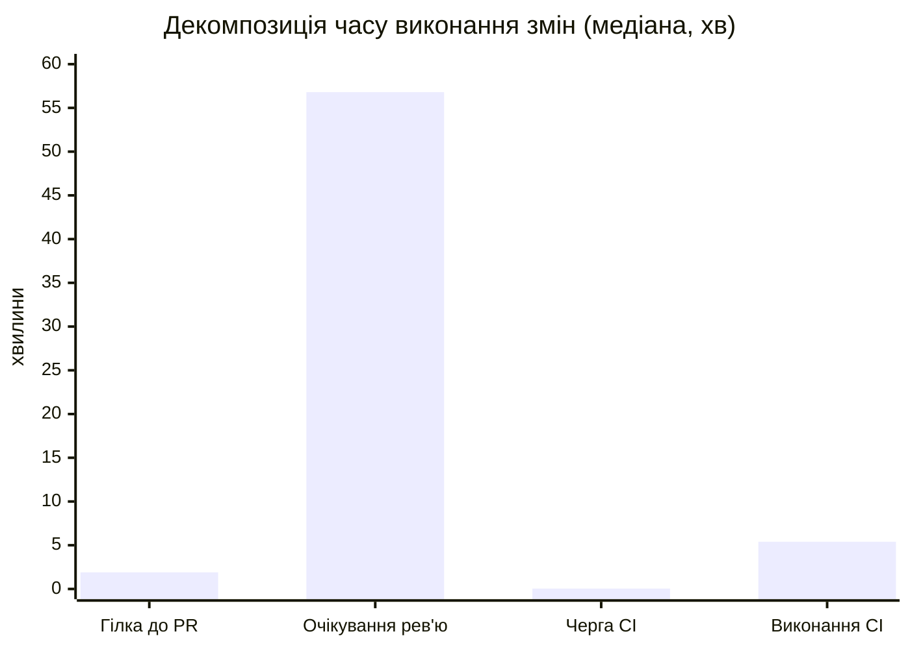
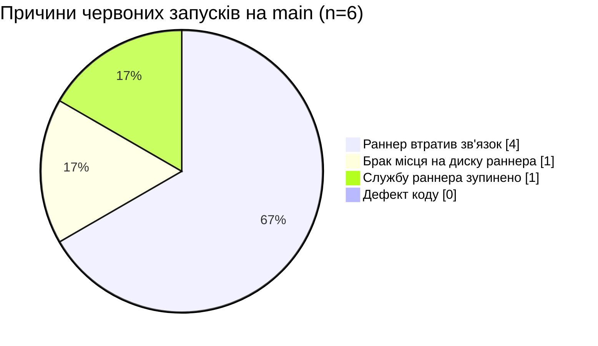
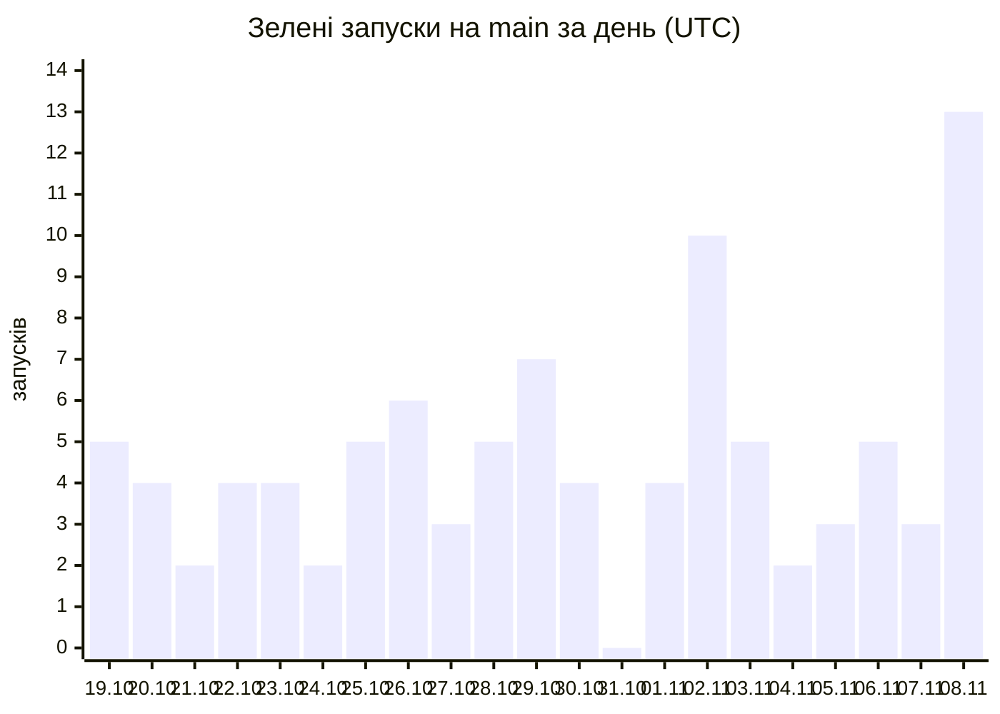

# Лабораторна 10 — Етапи 2–4: метрики DORA, першопричини, план покращень

**Репозиторій:** `ukma-fin-ssdm-2026/SSDM_12` · **Вікно:** 19.10–09.11.2026 (21 день = 3 тижні)
**Сирі дані:** [`metrics-raw.md`](metrics-raw.md) — 104 запуски `CI` на `main`

---

## 0. Що в цій лабораторній вважаємо розгортанням

| Рішення | Обґрунтування |
|---|---|
| **Одиниця розгортання = завершений запуск workflow `CI` на `main`** | `CI` — єдиний конвеєр, що проходить кожна зміна; він же обов'язкова перевірка PR. Усі 104 коміти у вікні прийшли зі змерджених PR, прямих пушів немає, тож «запуск на `main`» = «одна прийнята зміна» |
| **Зелений запуск = успішне розгортання** | — |
| **Червоний запуск = невдале розгортання** | — |
| **Скасовані (2) виключено з обох частин дробу** | Скасування — рішення людини (№18 скасував @dysett) або обрив раннера, а не відмова зміни. Для прозорості нижче наведено й варіант із ними |

> ⚠️ **Це наближення.** У визначенні DORA йдеться про розгортання **в робоче середовище**.
> У нас: `Release` (теги + GitHub Release) спрацював у вікні **4 рази**, а `render.yaml` описує
> *необов'язкове публічне демо*. Тобто «розгортання в прод» ≠ «зелений CI на main». Усі числа нижче —
> **проксі з телеметрії CI**, а не з продакшну; у цьому вони порівнянні з орієнтирами CircleCI,
> але з рівнями DORA — лише приблизно.

---

## 1. Етап 2: чотири метрики DORA

| Метрика | Формула | Наш результат | Рівень → частка опитаних DORA 2025 з таким або кращим результатом |
|---|---|---|---|
| **Частота розгортань** | 96 зелених / 3 тижні | **32,0 / тиждень** (4,6 / день) | **на вимогу (кілька разів на день)** → **16,2 %** |
| **Час виконання змін** | перший коміт PR → завершення зеленого запуску на `main` | **середнє 5,3 год** (315 хв) · **медіана 1,3 год** (80 хв) | **менше доби** → **24,4 %** |
| **Частота збоїв змін** | 6 червоних / 102 завершених | **5,9 %** | **4–8 %** → **36,2 %** |
| **Час відновлення** | червоний запуск → наступний зелений на `main` | **середнє 5,3 год** (316 хв) · **медіана 2,1 год** (124 хв) | **менше доби** → **56,5 %** |

**Чутливість результатів до припущень** (що питатимуть на захисті):

| Варіант підрахунку | Частота збоїв |
|---|---|
| Червоні / (зелені + червоні) — **основний** | 6/102 = **5,9 %** |
| Червоні / усі завершені, зі скасованими | 6/104 = 5,8 % |
| Тільки **дефекти коду** (інфраструктурні збої виключено) | 0/102 = **0 %** — див. §3 |

Розподіл часу виконання змін за кошиками DORA: **< 1 год — 37 (39 %)**,
< 1 доби — 57 (59 %), від доби до тижня — 2 (2 %), понад тиждень — 0.
Середнє (5,3 год) у 4 рази більше за медіану (1,3 год) — його тягне хвіст: PR #264 має 131 год,
бо перший коміт зроблено за 126 год до відкриття PR (довгоживуча гілка), а не через конвеєр.

---

## 2. Орієнтири з телеметрії CI (CircleCI, State of Software Delivery 2025–2026)

| Показник | Рекомендований орієнтир | Фактичне значення у даних 2025 | **Наше значення** | Вердикт |
|---|---|---|---|---|
| Частка успішних запусків на основній гілці | 90 % | 70,8 % | **94,1 %** | ✅ вище орієнтиру |
| Повернення основної гілки до зеленого | до 60 хв | 59,2 хв (медіана) | **124 хв (медіана)**, середнє 316 хв | ❌ удвічі гірше за орієнтир |
| Тривалість запуску workflow | до 10 хв | 2,2 хв (медіана) | **5,4 хв (медіана)**, p90 = 10,0 хв, max = 24,8 хв | ⚠️ у межах орієнтиру, але p90 на самій межі; 9 запусків його перетнули |

### Черга проти виконання

| Складова (зелені запуски) | Середнє, хв | Медіана, хв | p90, хв | Max, хв | Частка середнього часу виконання змін |
|---|--:|--:|--:|--:|--:|
| Черга на раннер | 11,1 | 0,05 | 8,7 | 421 | **3,5 %** |
| Виконання | 5,8 | 5,4 | 8,7 | 24,8 | **1,8 %** |
| **Разом CI** | **16,9** | **6,5** | 18,3 | 426 | **5,4 %** |

Усередині самого CI черга (зелені запуски) — **66 %** часу, виконання — 34 %.
Але CI — лише **5,4 %** усього часу виконання змін.

### Повна декомпозиція часу виконання змін

| Фаза | Середнє, хв | Медіана, хв | p90, хв | Max, хв | Частка (сер. / мед.) |
|---|--:|--:|--:|--:|--:|
| 1. Робота в гілці (1-й коміт → відкриття PR) | 109 | 1,9 | 52 | 7562 | 34,6 % / 2,3 % |
| 2. **Очікування рев'ю (PR відкрито → злито)** | **189** | **57** | **614** | 1678 | **60,0 % / 70,7 %** |
| 3. CI (черга + виконання) | 17 | 6,5 | 18 | 426 | 5,4 % / 8,0 % |
| **Разом** | **315** | **80** | 686 | 7847 | 100 % |

> **Ключовий висновок етапу 2:** вузьке місце — **не конвеєр**. Очікування рев'ю — 71 % медіанного
> часу виконання змін (p90 = 10,2 год), тоді як увесь CI — 8 %.
> Це протилежно типовому прикладу «70 % часу — черга»: у нас черга медіанно 3 секунди.

---

## 3. Етап 3: першопричини

### 3.1 Огляд інцидентів без пошуку винних (blameless postmortem, SWEBOK §4.4.2)

Питання етапу — «який дефект пройшов перевірки в PR непоміченим». **Відповідь: жоден.**
Усі 6 червоних запусків на `main` — відмови **інфраструктури єдиного self-hosted раннера**,
підтверджені анотаціями GitHub і логами:

| № | PR | Коли | Повідомлення з логу / анотації | Клас | Чи додасть тест захист? |
|--:|--:|---|---|---|---|
| 21 | #179 | 24.10 20:45 | `The self-hosted runner lost communication with the server` | fault середовища | ні — job не виконав жодного кроку |
| 35 | #206 | 26.10 21:45 | те саме; перед цим черга 107 хв | fault середовища | ні |
| 36 | #207 | 26.10 21:55 | те саме | fault середовища | ні |
| 56 | #241 | 01.11 17:29 | те саме | fault середовища | ні |
| 58 | #246 | 01.11 21:00 | `Недостаточно места на диске` на `Set up job` (`setup-java`, `C:\actions-runner-ssdm12\_work`) | fault ресурсу | ні — потрібне очищення, не тест |
| 86 | #290 | 06.11 13:54 | `The runner has received a shutdown signal. This can happen when the runner service is stopped, or a manually started runner is canceled` під час `pip install` | fault середовища | ні |

Спостереження, що випливають із цієї таблиці:

1. **Чотири однакові збої за 2 тижні — це патерн, не випадковість.** Усі чотири тривали **рівно 10 хв**:
   це heartbeat-таймаут GitHub, а не наш `timeout-minutes: 20`. Тобто раннер **прийняв** завдання
   (`startedAt` є), а потім машина зникла. Три з чотирьох — між 20:45 і 21:55 за Києвом.
2. **45 % злиттів (47 з 104) відбувається між 21:00 і 02:00** — саме тоді, коли машину з раннером
   найімовірніше вимикають або згортають. Збіг розподілів — найсильніше свідчення першопричини.
3. **Шлюз на PR справді ловить дефекти:** 31 червоний запуск на гілках PR проти 0 дефектів на `main`.
4. **Інфраструктурні збої псують метрику.** Частота збоїв 5,9 % говорить не про якість змін,
   а про доступність раннера. Поки їх не відокремити, метрика керує не тим.

### 3.2 Технічні причини

| # | Причина | Доказ із даних |
|--:|---|---|
| T1 | **Єдиний self-hosted раннер `SSDM12-Windows`** — одночасно єдина точка відмови і вся пропускна здатність | 113 виконань завдань на одній машині лише з `main`; 317 запусків `CI` за вікно (213 PR + 104 push) |
| T2 | **Немає моніторингу стану раннера** | 4 відмови «lost communication» за 2 тижні виявлено лише за червоним CI |
| T3 | **Немає очищення робочого каталогу** | `Недостаточно места на диске` у `_work/_actions/actions/setup-java` |
| T4 | **Декларована паралельність фіктивна:** `build` і `reliability` описані як окремі завдання, але на одному раннері виконуються послідовно | 9 запусків із 2 завданнями: медіана виконання **8,7 хв** проти **4,8 хв** для 1 завдання (+82 %); у запуску №103 друге завдання чекало 16 хв після першого |
| T5 | **Немає кешу залежностей** — кожне завдання щоразу робить `python -m venv` + повний `pip install -r requirements-testing.txt` (≈75 пакетів) | лог №86: `Installing collected packages:` ~75 пакетів; крок тривав 61 с і був єдиним, що встиг розпочатися |
| T6 | **Усе на кожен коміт**: lint, format, Bandit, detect-secrets, pip-audit, import-linter, покриття 90 %, PlantUML (завантаження + SHA-256), export OpenAPI — одним завданням, широкі інтеграційні тести на PostgreSQL щоразу (SWEBOK §3.3.3, §3.6) | 9 запусків > 10 хв, max 24,8 хв |
| T7 | **Немає `concurrency` для PR-гілок** — застарілі запуски не скасовуються і займають єдиний раннер | у `ci.yml` немає блоку `concurrency` (на відміну від `release.yml`, де він є) |

### 3.3 Організаційні та культурні причини

| # | Причина | Доказ із даних |
|--:|---|---|
| O1 | **Немає відповідального за стан конвеєра** (SWEBOK §1.8.2) — зламана `main` чекає, поки хтось помітить | медіана відновлення 124 хв проти орієнтиру 60 хв; нічні збої (№35, №36) лагодили аж 750 хв (до 10:15 наступного дня) |
| O2 | **PR лежать без рев'ю** | очікування рев'ю: медіана 57 хв, **p90 = 10,2 год**, max 28,0 год — PR #294 чекав 28 год |
| O3 | **Довгоживучі гілки** (SWEBOK §1.3.2, §1.3.6): PR відкривають не одразу після першого коміту | PR #264: 126 год від першого коміту до відкриття PR, загальний час виконання змін 131 год |
| O4 | **Великі PR** | 21 PR із 104 змінюють > 400 рядків, 5 — понад 1000; max 21490 рядків і 137 файлів |
| O5 | **Робота вночі** — тоді ж, коли раннер найменш надійний | 47 з 104 злиттів між 21:00 і 02:00; порожнє вікно 03:00–09:00 |

### 3.4 План покращень (Improvement Backlog)

Відповідальних **узгодити на парі** — нижче пропозиція за тим, хто вже дотичний до відповідної частини.

| Метрика | Проблема | Першопричина | Дія | Відповідальний |
|---|---|---|---|---|
| Частота збоїв змін | 5,9 %, усі 6 збоїв — інфраструктурні | T1, T2: раннер вимикається, про це ніхто не знає | підняти **другий раннер** (або перевести кроки без залежності від Windows+PostgreSQL на `ubuntu-latest`) | @NykytaBabakov |
| Частота збоїв змін | те саме | T2 | **моніторинг доступності раннера**: перевірка `status=online` перед злиттям + сповіщення в чат, коли offline | @dysett |
| Частота збоїв змін | збій через брак місця (№58) | T3 | крок **очищення** `_work`/temp на початку job + щотижневий prune кешів | @DziubakPavlo |
| Частота збоїв змін | метрика змішує дефекти й інфраструктуру | немає класифікації | стовпець **«клас збою» (defect / infra)** у `metrics-raw.md`; CFR рахувати за дефектами, infra — окремим SLI доступності | @NykytaBabakov |
| Час відновлення | медіана 124 хв > орієнтир 60 хв | O1: немає чергового | роль **«Build cop»** на тиждень у `TeamCharter.md` + правило «червона `main` лагодиться до будь-якого нового merge» | @asyakozulina |
| Час відновлення | нічні збої помічають зранку (750 хв) | O1, O5 | **сповіщення на failure на `main`** у командний чат; не мержити після 22:00, якщо раннер не підтверджено online | @dysett |
| Час виконання змін | медіана 80 хв, з них 71 % — очікування рев'ю | O2 | **SLA на перше рев'ю ≤ 4 год** у робочий день; два фіксовані рев'ю-слоти на день | @asyakozulina |
| Час виконання змін | хвіст: 131 год у PR #264 | O3, O4 | відкривати **draft PR одразу** після першого коміту; дрібнити PR > 400 рядків | @DziubakPavlo |
| Час виконання змін | p90 черги 12,7 хв, max 421 хв | T1, T7 | `concurrency: { group: ci-${{ github.ref }}, cancel-in-progress: true }` для PR-гілок, щоб застарілі запуски не займали раннер | @NykytaBabakov |
| Тривалість запуску | медіана 5,4 хв, p90 10,0 хв, +82 % після додавання `reliability` | T4, T5 | **кеш залежностей** (`actions/cache` для pip wheels або спільний venv) — прибирає ~1 хв × кількість завдань | @DziubakPavlo |
| Тривалість запуску | усе на кожен коміт | T6 | **розділити набори**: швидкий на PR (ruff, format, traceability, release-check, Bandit — секунди), повний після злиття в `main` (PostgreSQL-інтеграційні, PlantUML, покриття) — SWEBOK §2.3.6 | @asyakozulina |
| Частота розгортань | 32,0/тиждень — вже «на вимогу», але 47 з 104 злиттів уночі | O5 | рівномірніше впродовж дня; це передумова для решти дій, а не самоціль — метрика вже на найкращому рівні | вся команда |

> **Чого свідомо не робимо:** не підвищуємо частоту розгортань (вона вже на найвищому рівні DORA) і
> не знижуємо кількість перевірок у шлюзі — саме вони тримають 0 дефектів на `main`. Оптимізуємо
> **доступність раннера** і **час очікування рев'ю**.

---

## 4. Етап 4: дашборд

### 4.1 Зведення

| Метрика DORA | Значення | Рівень | Частка опитаних DORA 2025 з таким або кращим | Орієнтир CI |
|---|---|---|---|---|
| Частота розгортань | 32 /тиждень (4,6 /день) | на вимогу | 16,2 % | — |
| Час виконання змін | мед. 1,3 год · сер. 5,3 год | менше доби | 24,4 % | — |
| Частота збоїв змін | 5,9 % | 4–8 % | 36,2 % | успішність 94,1 % проти 90 % ✅ |
| Час відновлення | мед. 2,1 год · сер. 5,3 год | менше доби | 56,5 % | 124 хв проти 60 хв ❌ |

### 4.2 Де витрачається час виконання змін (медіана, хв)

> Графіки — Mermaid, щоб версіонувалися в репозиторії разом із документом. Якщо ваш рендерер не
> підтримує `xychart-beta`, ті самі числа є в таблицях §2 і §4.1.

### 4.3 Причини 6 червоних запусків на `main`

### 4.4 Зелені запуски на `main` за днями

### 4.5 Один ключовий висновок

> **Ми зливаємо в `main` у середньому 4,6 зміни на день і тримаємо 0 дефектів коду на `main`, але
> 71 % часу виконання змін зміна просто чекає на рев'ю, а всі 6 «збоїв розгортання» —
> це одна й та сама машина з раннером, яку вимикають уночі.**
>
> Тобто обидві «погані» метрики — частота збоїв 5,9 % і час відновлення 124 хв —
> вимірюють не якість нашого коду, а доступність одного комп'ютера.

### 4.6 Одна дія до наступного тижня

**Прибрати єдину точку відмови + дати їй видимість:**
1. Додати другий раннер (або перевести кроки, що не вимагають Windows + локального PostgreSQL, на `ubuntu-latest`).
2. Увести роль **Build cop** на тиждень і сповіщення в чат на `failure` на `main`.
3. Додати в `metrics-raw.md` стовпець класу збою (defect / infra) і рахувати CFR за дефектами.

Очікуваний ефект, перевірюваний тими самими командами через тиждень: частота збоїв → 0–2 % (рівень 8,5 %),
час відновлення → < 60 хв, p90 черги → < 5 хв.

---

## 5. Нотатка «Використання ШІ» (статут §8.3, політика курсу)

| Що | Деталі |
|---|---|
| **Інструмент** | Claude (Opus 5) з доступом до `gh` CLI та GitHub REST API |
| **Що згенеровано** | скрипти збору й обчислення (`gh api` → JSON → Python), обидва документи `docs/ci-cd/*.md`, формулювання першопричин і плану покращень |
| **Що НЕ згенеровано, а виміряно** | усі числа взято з GitHub API: `/actions/runs`, `/actions/runs/<id>/jobs`, `/commits/<sha>/pulls`, `/pulls/<n>/commits`, `/check-runs/<job_id>/annotations`, `gh run view --log-failed`. Жодне значення не оцінене «на око» |
| **Межі даних** | API Actions частково закритий через проксі (`/actions/runners` недоступний), тому стан раннера взято з полів `runner_name` у завданнях, а не зі сторінки раннерів. Автодеплой Render у репозиторії не задокументовано — тому розгортанням у проді його не називаємо |
| **Як верифікувати** (зробити перед захистом) | 1) повторити команди з §«Як зібрано дані» у `metrics-raw.md` і зіставити 104 рядки; 2) відкрити 2–3 червоні запуски в Actions і перевірити, що в анотації саме «lost communication» / «недостаточно места»; 3) перерахувати 32,0/тиждень, 5,9 %, медіани вручну хоч для одного тижня; 4) перевірити, що в `ci.yml` справді `runs-on: [self-hosted, Windows, X64]` і немає блоку `concurrency` |
| **Що я мушу вміти пояснити сам** | чому розгортанням вважаємо зелений CI на `main` і чому це наближення; чому скасовані виключено з дробу; чому середнє у 4 рази більше за медіану; чому 2 завдання на одному раннері не паралельні; чому 31 червоний PR — це добре, а 6 червоних на `main` — погано |
