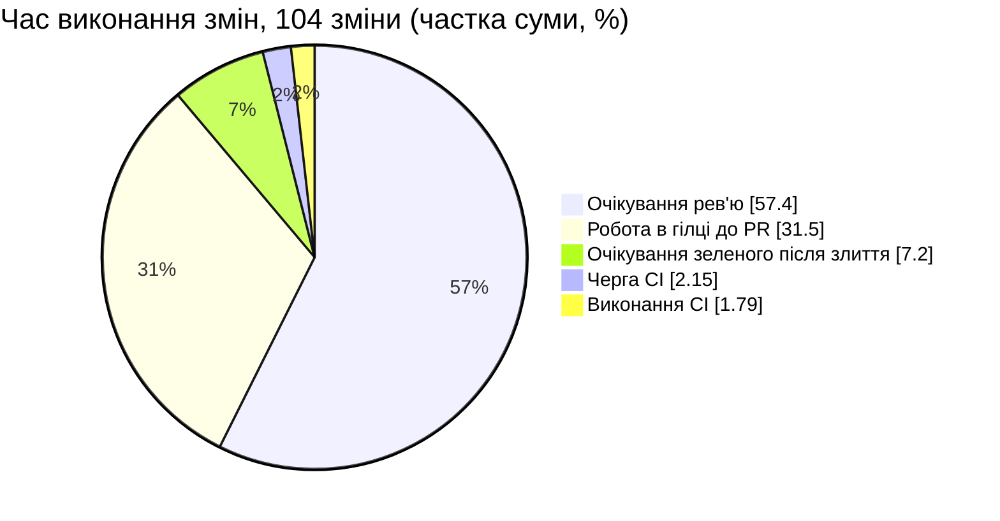
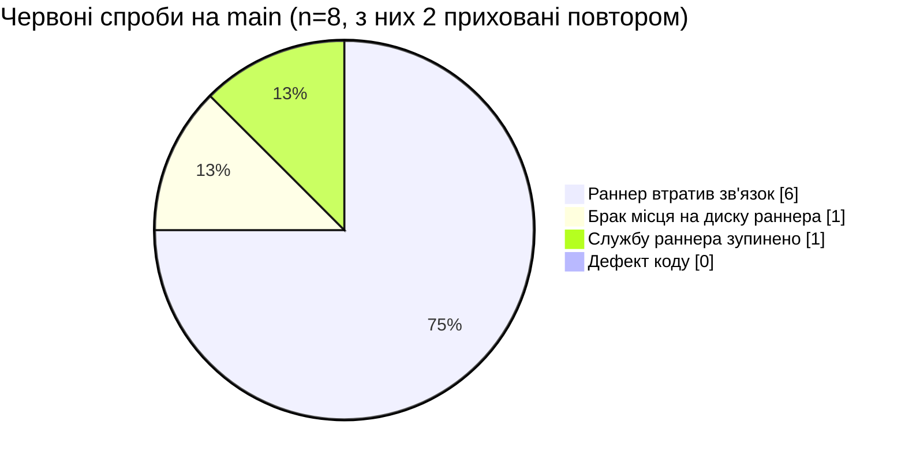
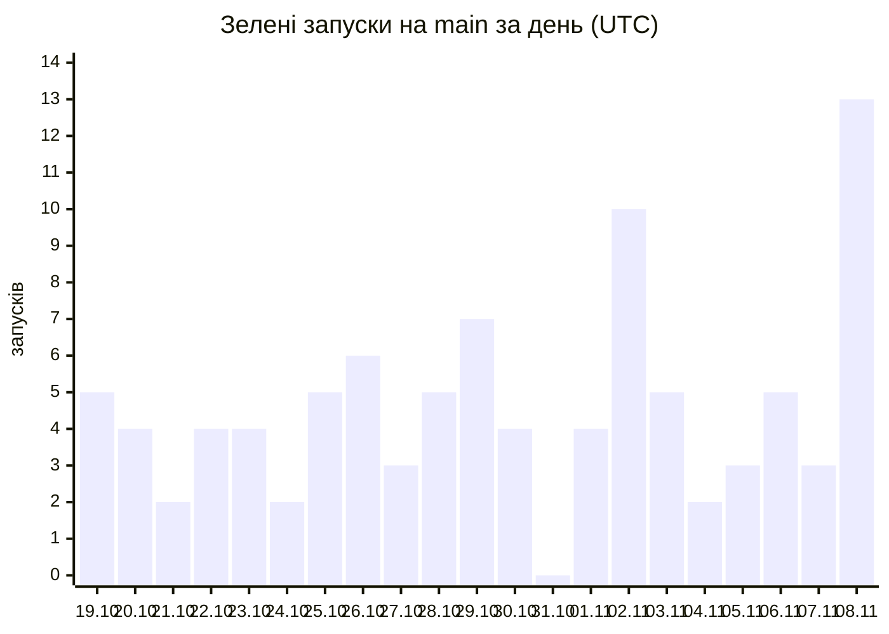

# Лабораторна 10 — Етапи 2–4: метрики DORA, першопричини, план покращень

**Репозиторій:** `ukma-fin-ssdm-2026/SSDM_12` · **Вікно:** 19.10–09.11.2026 (21 день = 3 тижні)
**Сирі дані:** [`metrics-raw.md`](metrics-raw.md) — 104 запуски `CI` на `main`; докази — [`evidence/`](evidence/);
автоматичний розрахунок тих самих метрик — [`dora-auto.md`](dora-auto.md) (`scripts/dora_metrics.py`, бонус 1).

**Редакція 2 (домашнє завдання).** Р. 1 зроблено на парі 09.11 (PR #315). У р. 2 метрики
перераховано строго за визначеннями курсу й звірено зі скриптом бонусу 1: у знаменнику частоти
збоїв тепер і скасовані запуски; час виконання змін — для всіх 104 змін, а не лише для 96 із
власним зеленим запуском; черга запуску з повторною спробою — без артефакту повтору. Додано
повторні спроби, тижневу динаміку, парний аналіз і розділ «Яку біль у нашій команді виявили ці
метрики?». Що саме змінилось у числах — §1.3.

---

## 0. Визначення: що вважаємо розгортанням і які workflow враховано

| Термін | Визначення курсу | Як застосовано в нас |
|---|---|---|
| Розгортання | успішний (зелений) запуск CI на `main` | завершений зелений запуск workflow **`CI`** з подією `push` на `main`; береться остання спроба — так, як показує `gh run list` |
| Невдала зміна | червоний запуск CI на `main`; червоні запуски на PR не рахуються | висновок `failure`, `timed_out` або `startup_failure`; 213 запусків PR у вікні (31 червоний) — поза підрахунком |
| Частота збоїв змін | червоні / усі завершені запуски на `main` | 6 / 104: два скасовані запуски теж завершені, тож вони в знаменнику |
| Час відновлення | від червоного запуску на `main` до наступного зеленого | від завершення червоного запуску до завершення наступного зеленого — для кожного червоного окремо |
| Час виконання змін | від першого коміту злитого PR до завершення зеленого запуску на `main`, що містить цей коміт | дата автора першого коміту PR → завершення першого зеленого запуску цього або пізнішого коміту: `main` лінійний, тож пізніший коміт містить попередній |
| Черга й виконання | черга — частина часу виконання змін; записуються окремо | черга — старт спроби → старт її першого job; виконання — старт першого job → завершення останнього |

**Які workflow враховано — лише `CI`.** Правило курсу для кількох workflow: коміт зелений, лише
якщо зелені всі враховані workflow, і червоний, якщо червоний хоч один.

- **`CI`** — єдиний конвеєр, який проходить кожна зміна: перевірки вимог і простежуваності,
  статичний аналіз, тести, обов'язкові перевірки `build` і `reliability` ruleset `main-protection`.
- **`API docs`** не враховано: він публікує документацію API на GitHub Pages, а не систему, і
  запускається лише для змін у `src/api/` чи `docs/api/` — 20 зі 104 комітів. Рішення не змінює
  висновків: скрипт бонусу 1 з `--workflow CI --workflow "API docs"` дає ті самі 96 зелених,
  6 червоних і 2 скасовані коміти (усі 20 запусків `API docs` зелені); середній час виконання
  змін — 5,40 год замість 5,38.
- **`Release`** (тег і GitHub Release; 4 запуски у вікні) не враховано: він випускає версію раз
  на кілька днів, а не кожну зміну.

> ⚠️ **Це наближення.** У DORA розгортання — у робоче середовище. Наше «розгортання» — зелений
> CI на `main`: у цей момент застосунок нікуди не викочується (`render.yaml` описує необов'язкове
> публічне демо без автодеплою з CI). Тому рівні DORA нижче — орієнтир, а не порівняння з
> продакшном; з орієнтирами CircleCI, які теж рахують із телеметрії CI, наші числа порівнянні.
> Бонус 5 додає справжній артефакт — образ контейнера з кожного зеленого запуску — і метрики за
> цим визначенням поруч.

---

## 1. Етап 2: чотири метрики DORA

### 1.1. Результат

| Метрика | Формула | Наш результат | Рівень DORA 2025 → частка опитаних із таким або кращим |
|---|---|---|---|
| **Частота розгортань** | 96 зелених / 3 тижні | **32,0 / тиждень** (4,6 / добу) | на вимогу (кілька разів на день) → **16,2 %** |
| **Час виконання змін** | перший коміт PR → завершення зеленого запуску з цим комітом | **медіана 1,56 год** (93 хв) · середнє 5,38 год · p90 12,2 год · змін 104 | менше доби → **24,4 %** |
| **Частота збоїв змін** | червоні / усі завершені | **5,8 %** (6 / 104) | 4–8 % → **36,2 %** |
| **Час відновлення** | червоний → наступний зелений | **медіана 124 хв** (2,1 год) · середнє 316 хв (5,3 год) · випадків 6 | менше доби → **56,5 %** |

Дані CI — не продакшн, тому рівні наближені. Розподіл часу виконання змін за рівнями DORA:
менше години — 37 змін (35,6 %), менше доби — 65 (62,5 %), від доби до тижня — 2 (1,9 %). Середнє в
3,5 раза більше за медіану: його тягне хвіст — PR #264 (131 год: перший коміт зроблено за 126 год
до відкриття PR) і зміни, що чекали ранку після нічних збоїв раннера (№35, №36).

### 1.2. Чутливість до припущень

| Припущення | Варіант | Результат | Чи змінюється рівень |
|---|---|---|---|
| Скасовані в знаменнику частоти збоїв | без скасованих: 6 / 102 | 5,9 % | ні — 4–8 % |
| Кожна повторна спроба — окремий прогін конвеєра | 8 червоних спроб зі 106 | 7,5 %; відновлення: медіана 145 хв, середнє 309 хв, 8 випадків | ні |
| Кілька червоних поспіль — один інцидент | 5 інцидентів | відновлення: медіана 114 хв, середнє 232 хв | ні |
| Рахувати лише дефекти коду | 0 / 104 | 0 % | так — 0–2 % → 8,5 % |
| Рівень частоти розгортань | за числом 4,6 / добу підпадає й під «від разу на годину до разу на добу» | → 22,7 % | так, на рівень нижче |
| Враховувати й `API docs` | правило кількох workflow | ті самі 96 / 6 / 2; середній час виконання змін 5,40 год | ні |

Рівень частоти розгортань — «на вимогу»: зміну зливаємо, щойно PR схвалено, без розкладу. Але
опитування DORA самозвітне, і за самим числом 4,6 / добу відповідає й рівню «від разу на годину до
разу на добу». Обидва — верхня чверть опитаних.

### 1.3. Що змінилось порівняно з р. 1

| Показник | Р. 1 (09.11, вручну) | Р. 2 | Чому |
|---|---|---|---|
| Частота збоїв | 5,9 % (6 / 102) | **5,8 % (6 / 104)** | курс рахує «усі завершені» — скасовані теж |
| Успішність на `main` (CircleCI) | 94,1 % | **92,3 %** (96 / 104) | той самий знаменник |
| Час виконання змін | медіана 1,3 год, середнє 5,3 год, 96 змін | **медіана 1,56 год, середнє 5,38 год, 104 зміни** | 8 змін, чий власний запуск червоний чи скасований, теж розгорнуто — з наступним зеленим запуском |
| Частка черги в часі виконання змін | 3,5 % | **2,15 %** | «черга» 420,6 хв запуску №40 — це червона перша спроба й 6,8 год до ручного повтору |
| Черга: max / p90 | 421 / 12,7 хв | **368,8 / 8,7 хв** | те саме; p90 — методом найближчого рангу |
| Час у рядках 1–24 `metrics-raw.md` | UTC+2 | **UTC+3 до 25.10** | перехід на зимовий час; тривалості не змінились |
| Повторні спроби | не враховано | **2 запуски; 8 червоних спроб зі 106** | `gh run list` показує лише останню спробу |

### 1.4. Динаміка за тижнями

| Тиждень (UTC) | Запусків | Розгортань | Час виконання змін, медіана | Червоних | Частота збоїв | Відновлення, медіана | Виконання CI, медіана | Очікування рев'ю, медіана |
|---|--:|--:|--:|--:|--:|--:|--:|--:|
| 19.10–25.10 | 28 | 26 | 3,0 год | 1 | 3,6 % | 94 хв | 3,3 хв | 81 хв |
| 26.10–01.11 | 33 | 29 | 1,6 год | 4 | 12,1 % | 437 хв | 4,4 хв | 65 хв |
| 02.11–08.11 | 43 | 41 | 1,15 год | 1 | 2,3 % | 114 хв | 7,3 хв | 42 хв |

Порахувано тим самим скриптом із вікнами по тижню. Тиждень 26.10–01.11 — нічні відмови раннера
(№35, №36) і №56; виконання CI за три тижні зросло більш ніж удвічі — додались ворота Лаб 5–9 і
job `reliability`.

---

## 2. Орієнтири CircleCI, черга й виконання

| Показник | Рекомендований орієнтир | Фактичне 2025 | **Наше значення** | Вердикт |
|---|---|---|---|---|
| Частка успішних запусків на основній гілці | 90 % | 70,8 % | **92,3 %** (96 / 104) | ✅ вище орієнтиру |
| Повернення основної гілки до зеленого | до 60 хв | 59,2 хв (медіана) | **124 хв** (медіана), середнє 316 хв | ❌ удвічі гірше |
| Тривалість запуску workflow | до 10 хв | 2,2 хв (медіана) | **5,4 хв** (медіана), p90 10,0 хв, max 24,8 хв | ⚠️ у межах, але p90 на межі: 9 запусків понад 10 хв |

### 2.1. Яка частка часу виконання змін — черга, а яка — виконання

| Фаза | Медіана, хв | Середнє, хв | Частка суми часу виконання змін |
|---|--:|--:|--:|
| 1. Робота в гілці (1-й коміт → відкриття PR) | 2,2 | 101,7 | 31,5 % |
| 2. **Очікування рев'ю** (PR відкрито → злито) | **56,8** | **185,4** | **57,4 %** |
| 3. Очікування зеленого після злиття (8 змін із червоним чи скасованим власним запуском) | 0 | 23,3 | 7,2 % |
| 4. **Черга CI** | 0,05 | 6,9 | **2,15 %** |
| 5. **Виконання CI** | 5,4 | 5,8 | **1,79 %** |
| **Разом** | **93,3** | **323** | 100 % |

Черга й виконання — того зеленого запуску, що завершив відлік зміни. Усередині CI черга —
**54 %** часу (6,9 з 12,7 хв у середньому), але медіанно черга — 3 секунди: її середнє тягнуть
кілька нічних пачок (№20 — 368,8 хв, №35 — 107 хв). Увесь CI — **менше 4 %** часу виконання змін.

> **Ключовий висновок етапу 2:** вузьке місце — **не конвеєр**. Зміна найдовше чекає на рев'ю
> (57 % часу) і на роботу в гілці до відкриття PR (32 %); черга й виконання CI разом — 4 %.
> Це протилежно прикладу з умови («70 % часу — черга»): у нас медіанна черга — 3 секунди.

---

## 3. Етап 3: першопричини

### 3.1 Огляд кожного червоного запуску без пошуку винних (blameless postmortem, SWEBOK §4.4.2)

Питання етапу — який дефект пройшов перевірки PR непоміченим і яку перевірку додати.
**Дефектів коду серед них немає.** Усі вісім червоних спроб на `main` — шість червоних запусків і
дві приховані, перші спроби запусків №40 і №56 (`run_attempt` = 2), — відмови інфраструктури
єдиного self-hosted раннера, підтверджені анотаціями GitHub і логами (`evidence/`). Тест таку
відмову не зловить: job або не виконав жодного кроку, або обірвався посеред встановлення
залежностей. Тому «перевірка, яку додаємо», — перевірка середовища й процесу, а не коду.

| № | PR | Завершено (Київ) | Що в анотації чи лозі | Клас | Яку перевірку додаємо | Наступний зелений на `main` |
|--:|--:|---|---|---|---|---|
| 21 | #179 | 24.10 21:45 | `The self-hosted runner lost communication with the server`: job без жодного кроку, рівно 10 хв — тайм-аут heartbeat GitHub, а не наш `timeout-minutes` | `infra` | перевірка, що раннер `online`, перед вечірнім злиттям (Ч-1); сповіщення в Teams про червоний `main` (В-2) | №22, PR #180 — через 94 хв |
| 35 | #206 | 26.10 23:45 | те саме; перед цим черга 107 хв | `infra` | те саме; не зливати після 22:00 без підтвердженого раннера (Ч-1) | №37, PR #209 — через 750 хв, наступного ранку |
| 36 | #207 | 26.10 23:55 | те саме | `infra` | те саме | №37 — через 740 хв |
| 40, спроба 1 | #213 | 28.10 12:42 | те саме. **Прихований збій:** після ручного повтору запуск зелений, і `gh run list` показує ✅ | `infra` | повторні спроби — окремим списком у звіті (бонуси 1 і 4); `main` був червоним 6,9 год до успішного завершення повтору | спроба 2 того самого запуску стартувала через 6,8 год після завершення першої спроби |
| 56, спроби 1 і 2 | #241 | 01.11 19:06 і 19:29 | те саме двічі поспіль: повтор потрапив на той самий недоступний раннер | `infra` | перед повтором перевірити, що раннер `online` (В-3) | №57, PR #243 — через 157 хв від першої спроби |
| 58 | #246 | 01.11 23:00 | `Недостаточно места на диске` на кроці `Set up job` (`setup-java`, `C:\actions-runner-ssdm12\_work`) | `infra` | обмежений кеш середовищ — не більше трьох (бонус 2, зроблено); крок перевірки вільного місця на початку job (З-2) | №59, PR #247 — через 66 хв після збою на тому самому раннері. Як саме звільнили місце, журнал не фіксує. |
| 86 | #290 | 06.11 15:54 | `The runner has received a shutdown signal` під час `pip install` | `infra` | недобудоване середовище не використовується повторно: маркер готовності пишеться останнім (бонус 2, зроблено) | О 17:40 за Києвом раннер знову підключився до GitHub і почав приймати завдання. Наступний зелений — №87, PR #288 — через 114 хв |

Спостереження, які випливають із таблиці:

1. **Шість спроб з восьми — те саме повідомлення «lost communication», і всі тривали рівно 10 хв.**
   Раннер **прийняв** завдання (`started_at` є), а потім машина зникла. П'ять із шести — увечері,
   між 19:00 і 24:00 за Києвом, — тоді, коли комп'ютер із раннером найімовірніше вимикають,
   присипляють чи забирають із собою.
2. **48 зі 104 злиттів (46 %) відбуваються між 21:00 і 02:00** (з урахуванням переходу на зимовий
   час), а між 03:00 і 09:00 — жодного. Збіг цих двох розподілів — найсильніше свідчення
   першопричини.
3. **Повторний запуск ховає збій від метрики.** Запуск №40 у `gh run list` зелений, хоча `main`
   6,9 год був червоним. Без поля `run_attempt` цей збій не потрапляє ні в частоту збоїв, ні в
   час відновлення — тому в §1.2 є варіант «на рівні спроб» (7,5 %).
4. **Шлюз на PR справді ловить дефекти:** 31 червоний запуск на гілках PR і 0 дефектів коду на
   `main`. Частота збоїв 5,8 % говорить не про якість змін, а про доступність одного комп'ютера.

### 3.2 Технічні причини

| # | Причина | Доказ із даних |
|--:|---|---|
| T1 | **Єдиний self-hosted раннер `SSDM12-Windows`** — одночасно єдина точка відмови й уся пропускна здатність | 317 запусків `CI` за вікно (213 PR + 104 `main`) на одній машині; 8 із 8 червоних спроб на `main` — ця машина |
| T2 | **Немає моніторингу стану раннера й сповіщень** | про 6 відмов «lost communication» дізнавались лише з червоного CI; №56 повторили на тому самому недоступному раннері |
| T3 | **Немає очищення й обмеження кешів на раннері** | `Недостаточно места на диске` у `_work/_actions/actions/setup-java` (№58) |
| T4 | **Паралельність лише на папері:** `build` і `reliability` — окремі jobs, але на одному раннері виконуються послідовно | 9 запусків із двома jobs: медіана виконання 8,7 хв; у №103 друге завдання чекало 16 хв після першого |
| T5 | **Немає кешу залежностей:** кожен job щоразу робить `python -m venv` і повний `pip install` (≈ 75 пакетів) | кроки `Install …` — 41–85 с у `build` і 39–78 с у `reliability`, тобто ≈ 2 хв на запуск; №86 обірвався саме на цьому кроці |
| T6 | **Усе на кожен коміт:** статичний аналіз, PlantUML, покриття 90 % і інтеграційні тести на справжньому PostgreSQL — одним job на кожен PR (SWEBOK §3.3.3, §3.6) | крок тестів — медіанно 163 с, найдовший крок job `build`; 9 запусків понад 10 хв |
| T7 | **Немає `concurrency` для гілок PR:** застарілі запуски PR не скасовуються й займають єдиний раннер | у `ci.yml` блоку `concurrency` немає (у `release.yml` він є) |
| T8 | **Конвеєр росте, і кожна нова перевірка — хвилини для всіх** | медіана виконання CI за тижнями 3,3 → 4,4 → 7,3 хв (§1.4) — додались ворота Лаб 5–9 і job `reliability` |

### 3.3 Організаційні та культурні причини

| # | Причина | Доказ із даних |
|--:|---|---|
| O1 | **Немає відповідального за стан конвеєра** (SWEBOK §1.8.2) — зламаний `main` чекає, поки хтось помітить | медіана відновлення 124 хв проти орієнтиру 60 хв; нічні збої №35, №36 полагодили через 750 хв; №40 стояв червоним 6,9 год до завершення ручного повтору |
| O2 | **PR чекають на рев'ю** | очікування рев'ю — 70,7 % медіанного часу виконання змін: медіана 57 хв, p90 10,2 год, max 28 год (PR #294) |
| O3 | **Довгоживучі гілки** (SWEBOK §1.3.2, §1.3.6): PR відкривають не одразу після першого коміту | робота в гілці до PR — 2,3 % медіанного часу виконання змін; PR #264: 126 год від першого коміту до відкриття PR |
| O4 | **Великі PR** | 21 PR зі 104 змінюють понад 400 рядків, 5 — понад 1000; max — 21 490 рядків і 137 файлів |
| O5 | **Злиття вночі** — саме тоді, коли раннер найменш надійний | 48 зі 104 злиттів між 21:00 і 02:00; жодного між 03:00 і 09:00; 31.10 — жодного розгортання |
| O6 | **Автоматичні PR теж лежать днями** — ще один прояв O2 | 10 відкритих PR Dependabot станом на 09.11, найстаріші — з 23.10 (17 днів) |

### 3.4 План покращень (Improvement Backlog)

Для кожної з чотирьох метрик — дві–три дії з відповідальним. Відповідальні погодились у Teams
10.11 і підтвердили це рецензією PR із цим розділом. Чотири дії вже реалізовано як бонуси —
їхній виміряний ефект у розділі «Бонуси».

| ID | Метрика | Проблема | Першопричина | Дія | Відповідальний | Стан |
|---|---|---|---|---|---|---|
| Ч-1 | Частота розгортань | 48 зі 104 злиттів уночі, коли раннер найменш надійний; 31.10 — жодного розгортання | O5, T1 | правило в `CONTRIBUTING.md`: після 22:00 зливати лише за підтвердженого `online` раннера | @asyakozulina | запропоновано |
| Ч-2 | Частота розгортань | «розгортання» нікуди не викочує артефакт | немає артефакту релізу | образ контейнера з кожного зеленого запуску в ghcr.io | @NykytaBabakov | **зроблено — бонус 5** |
| Ч-3 | Частота розгортань | 10 PR Dependabot чекають до 17 днів | O6 | щопонеділка 15 хв на PR Dependabot: злити сумісні, закрити несумісні з причиною | @dysett | запропоновано |
| Ш-1 | Час виконання змін | 70,7 % медіанного часу — очікування рев'ю | O2 | перше рев'ю — до 4 год у робочий час; два фіксовані слоти рев'ю на день | @asyakozulina | запропоновано |
| Ш-2 | Час виконання змін | 2,3 % медіанного часу — робота в гілці до PR; 21 PR понад 400 рядків | O3, O4 | draft PR одразу після першого коміту; PR понад 400 рядків ділити | @DziubakPavlo | запропоновано |
| Ш-3 | Час виконання змін | виконання CI зросло 3,3 → 7,3 хв; ≈ 2 хв на запуск — встановлення залежностей | T5, T8 | кешоване середовище на постійному раннері | @DziubakPavlo | **зроблено — бонус 2** |
| Ш-4 | Час виконання змін (зворотний зв'язок PR) | PR чекає весь набір тестів разом з інтеграційними на PostgreSQL — найдовший крок `build` | T6 | швидкий набір на кожен PR, повільний — після злиття в `main` | @dysett | **зроблено — бонус 3** |
| З-1 | Частота збоїв змін | 6 червоних зі 104, усі — раннер | T1, T2 | другий раннер або перенесення кроків, що не потребують Windows і PostgreSQL, на `ubuntu-latest` | @NykytaBabakov | запропоновано |
| З-2 | Частота збоїв змін | №58 — брак місця на диску | T3 | На початку job перевіряти вільне місце на томі кешу; попереджати, якщо менше 10 GiB, і зупиняти job, якщо менше 5 GiB | @DziubakPavlo | частково: кеш — зроблено; перевірку місця — запропоновано |
| З-3 | Частота збоїв змін | метрика змішує інфраструктуру з дефектами; повтор ховає збій | немає класифікації | клас збою (`infra` / `defect`) у `metrics-raw.md`; повторні спроби у звіті; ручний пошук нестабільних тестів | @dysett | **зроблено** — р. 2, бонуси 1 і 4 |
| В-1 | Час відновлення | медіана 124 хв проти 60 хв; уночі — 750 хв | O1 | роль «Build cop» на тиждень у статуті: червоний `main` лагодимо раніше за будь-яке нове злиття | @asyakozulina | запропоновано |
| В-2 | Час відновлення | про збій дізнаємось із червоного CI чужого PR | T2 | сповіщення в Teams на `failure` на `main` | @dysett | запропоновано |
| В-3 | Час відновлення | повтор на недоступному раннері нічого не дає (№56) | O1, T2 | у `CONTRIBUTING.md`: перш ніж повторювати запуск — перевірити `Settings → Actions → Runners`; хто повторює — пише в Teams | @DziubakPavlo | запропоновано |

> **Чого свідомо не робимо.** Не зменшуємо кількість перевірок у шлюзі PR — саме вони тримають
> 0 дефектів коду на `main`; не вимикаємо CI для змін лише в документації через `paths-ignore`:
> `build` — обов'язкова перевірка ruleset `main-protection`, і PR без неї завис би в стані
> «очікує на перевірку». Оптимізуємо доступність раннера, тривалість конвеєра й очікування рев'ю.

---

## 4. Етап 4: дашборд

### 4.1 Зведення

| Метрика DORA | Значення | Рівень DORA 2025 | Частка опитаних із таким або кращим | Орієнтир CircleCI |
|---|---|---|---|---|
| Частота розгортань | 32 / тиждень (4,6 / добу) | на вимогу | 16,2 % | — |
| Час виконання змін | медіана 1,56 год · середнє 5,38 год | менше доби | 24,4 % | — |
| Частота збоїв змін | 5,8 % (на рівні спроб — 7,5 %) | 4–8 % | 36,2 % | успішність 92,3 % проти 90 % ✅ |
| Час відновлення | медіана 2,1 год · середнє 5,3 год | менше доби | 56,5 % | 124 хв проти 60 хв ❌ |

> Графіки — Mermaid, щоб версіонувалися разом із документом. Якщо рендерер не підтримує
> `xychart-beta`, ті самі числа є в таблицях §1.4, §2.1 і §3.1.

### 4.2 Де витрачається час виконання змін (частка суми, %)



### 4.3 Причини 8 червоних спроб на `main`



### 4.4 Тижні: розгортання й червоні запуски

```mermaid
xychart-beta
    title "Розгортання (зелені) і червоні запуски на main за тижнями"
    x-axis ["19.10–25.10", "26.10–01.11", "02.11–08.11"]
    y-axis "запусків" 0 --> 45
    bar [26, 29, 41]
    bar [1, 4, 1]
```



Перший ряд — зелені запуски, другий — червоні. Медіана часу виконання змін за ці тижні:
3,0 → 1,6 → 1,15 год; медіана виконання CI: 3,3 → 4,4 → 7,3 хв (§1.4).

### 4.5 Зелені запуски на `main` за днями (UTC)



### 4.6 Один ключовий висновок

> **Ми зливаємо в `main` 4,6 зміни на день і не пропустили на `main` жодного дефекту коду, але
> зміна 57 % часу просто чекає на рев'ю, а всі вісім червоних спроб — це одна й та сама машина з
> раннером.** Обидві «погані» метрики — частота збоїв 5,8 % і відновлення 124 хв — вимірюють не
> якість нашого коду, а доступність одного комп'ютера й те, що зламаний `main` нічий.

### 4.7 Одна дія до наступного тижня

**Дати конвеєру власника й видимість:** роль «Build cop» на тиждень і сповіщення в Teams про
червоний `main` (дії В-1, В-2 у §3.4). Перевірка через тиждень — тими самими командами
(`scripts/dora_metrics.py`): медіана відновлення < 60 хв, жодного червоного `main` довше години.

Уже зроблено за тиждень домашнього завдання (бонуси, виміряний ефект — у розділі «Бонуси»):
кешоване середовище (Ш-3), швидкий і повільний набори тестів (Ш-4), пошук нестабільних тестів і
список повторних спроб (З-3), образ контейнера з кожного зеленого запуску (Ч-2).

---

## 5. Парний аналіз: швидкість разом зі стабільністю

Метрики читаємо парами: покращення однієї може погіршити сусідню.

| Пара | Швидкість | Стабільність | Що бачимо разом |
|---|---|---|---|
| Частота розгортань ↔ частота збоїв | 32 / тиждень; за тижнями 26 → 29 → 41 | 5,8 %; за тижнями 3,6 → 12,1 → 2,3 % | Частіші розгортання не зробили `main` менш стабільним: найшвидший тиждень (02.11–08.11) — і найстабільніший. Найгірший тиждень (26.10–01.11) поганий за обома, і причина спільна — нічні відмови раннера, а не зміни коду. |
| Час виконання змін ↔ час відновлення | медіана 93 хв | медіана 124 хв; у тиждень 26.10–01.11 — 437 хв | Зламаний `main` повертаємо довше, ніж доставляємо нову зміну. Для команди, що зливає 4,6 зміни на день, це головний ризик: поки `main` червоний, кожен наступний PR перевіряється на зламаній основі. Причина — немає власника стану конвеєра (O1), а не складність виправлень: жодне відновлення не потребувало зміни коду. |
| Тривалість CI ↔ успішність на `main` | виконання CI 3,3 → 7,3 хв за три тижні | 92,3 % успішних; 0 дефектів коду на `main`; 31 дефект зупинено на PR | Нові ворота якості коштують хвилин, але саме вони тримають `main` без дефектів коду. Поки CI — менше 4 % часу виконання змін, ця ціна прийнятна; ми скорочуємо її кешем і розділенням тестів, а не прибираючи перевірки. |

**Висновок.** У наших даних швидкість і стабільність не конфліктують: обидві впираються в одне —
у доступність єдиного раннера й у те, що за станом конвеєра ніхто не стежить. Тому план
покращень (§3.4) насамперед додає власника й видимість (В-1, В-2), а не гальмує розгортання.

---

## 6. Яку біль у нашій команді виявили ці метрики?

1. **Один комп'ютер — це весь наш конвеєр.** Усі вісім червоних спроб на `main` — раннер на
   комп'ютері учасника команди: зв'язок утрачено, закінчилось місце, зупинено службу. Коли
   комп'ютер вимкнено, не перевіряється жоден PR. Частота збоїв і час відновлення вимірюють
   доступність цієї машини, а не якість нашого коду (§3.1).
2. **Зміна найдовше чекає не на CI, а на колегу.** 57 % часу виконання змін — очікування рев'ю,
   ще 32 % — робота в гілці до відкриття PR; CI разом із чергою — менше 4 %. Навіть автоматичні PR
   Dependabot лежать до 17 днів (§2.1, §3.3).
3. **Зламаний `main` нічий.** Нічні збої полагодили через 12,5 год, а запуск №40 простояв
   червоним 6,9 год, поки хтось не натиснув «Re-run». Відновлення (медіана 124 хв) повільніше за
   доставку звичайної зміни (93 хв) — §5.
4. **Кожна нова перевірка — хвилини для всіх.** Виконання CI за три тижні зросло з 3,3 до 7,3 хв:
   ми додавали ворота Лаб 5–9, і два jobs на одному раннері йдуть послідовно. Це видно лише тоді,
   коли міряєш.
5. **Метрика може обманювати.** Повторний запуск ховає збій від `gh run list`; фіксований UTC+2
   зсунув години в половині рядків; від знаменника залежить, 5,8 % чи 5,9 %. Звідси правило:
   визначення — записане, дані — відтворювані скриптом, кожне число — з доказом у `evidence/`.

Що з цим робимо — §3.4: власник конвеєра й сповіщення (В-1, В-2), правила для рев'ю й розміру
PR (Ш-1, Ш-2), другий раннер (З-1). Метрики DORA — для покращення процесу команди, а не для
оцінки окремих людей.

---

## 7. Нотатка «Використання ШІ» (статут §8.3, політика курсу)

| Що | Деталі |
|---|---|
| **Інструмент** | Claude (Anthropic) з доступом до GitHub REST API (лише читання) |
| **Що згенеровано** | р. 1 на парі (PR #315): скрипти збору й обох документів; р. 2: перерахунок за визначеннями курсу, розділи §1.2–§1.4, §2.1, §5, §6, чернетка §3; скрипти бонусів і їхні тести; тексти PR |
| **Що НЕ згенеровано, а виміряно** | усі числа — з GitHub API (`/actions/runs`, `/attempts`, `/jobs`, `/commits/<sha>/pulls`, `/pulls/<n>/commits`, анотації) і відтворюються командою `scripts/dora_metrics.py` (бонус 1); жодне значення не оцінене «на око» |
| **Як перевірено** | Перевіряв лише я (@NykytaBabakov). Числа §1.1–§1.2 звірив з `docs/ci-cd/dora-auto.md` (бонус 1) — повний збіг. §1.4 (тижнева динаміка) і §2.1 рядок 3 перерахував повторно функцією `compute()` зі `scripts/dora_metrics.py` над уже зібраним `docs/ci-cd/evidence/dora-dataset.json`, без нового звернення до GitHub API: <br>`python3 -c "` <br>`import sys; from pathlib import Path` <br>`sys.path.insert(0, 'scripts')` <br>`from dora_metrics import load_dataset, compute, build_units, lead_times` <br>`from datetime import datetime, UTC` <br>`runs, meta = load_dataset(Path('docs/ci-cd/evidence/dora-dataset.json'))` <br>`for s, u in [((2026,10,19),(2026,10,26)), ((2026,10,26),(2026,11,2)), ((2026,11,2),(2026,11,9))]:` <br>`    print(compute(runs, datetime(*s, tzinfo=UTC), datetime(*u, tzinfo=UTC)))"` — три тижні збіглись із §1.4 (28/26/3,0 год/1/3,6 %/94 хв; 33/29/1,6 год/4/12,1 %/437 хв; 43/41/1,15 год/1/2,3 %/114 хв). Для §2.1 рядка 3 підсумував залишок `total − branch − review − queue − exec` з `lead_times(build_units(runs), inside)` по всіх 104 змінах: 2427,4 / 33601,7 хв = 7,224 % ≈ 7,2 %, медіана й середнє — 0 і 23,3 хв; збіг. |
| **Межі даних** | стан раннера взято з полів `runner_name` у jobs, а не зі сторінки раннерів (вона потребує прав адміністратора); автодеплою на Render у репозиторії немає, тож розгортанням у продакшн його не називаємо |
| **Що я мушу вміти пояснити сам** | чому розгортання — зелений CI на `main` і чому це наближення; чому скасовані в знаменнику; чому 104, а не 96 змін; чому середнє в 3,5 раза більше за медіану; чому два jobs на одному раннері не паралельні; чому повторний запуск ховає збій; чому 31 червоний PR — це добре, а 6 червоних на `main` — погано |

---

## Бонуси

Кожен бонус — +0,25 бала до загальної суми, лише якщо його зроблено **і** хтось пояснює його у
своєму відео (умова Лаб 10). Підрозділ заповнює власник бонусу, коли докази вже в `main`.
Бонусні workflow запускаються вручну або після зеленого `CI` на `main` і займають один раннер
на запуск.

### Бонус 1. Автоматичний розрахунок метрик — @asyakozulina

**Реалізація.** Створено `scripts/dora_metrics.py` та 55 модульних тестів у `tests/unit/test_dora_metrics.py` (зовнішні запити підмінено). Тимчасовий виняток QA-22 прибрано з `docs/requirements/rtm.md`. Скрипт запускається локально, читає GitHub API без змін даних на сервері (GET-запити), не додає запланованих workflow.

**Відтворення розрахунку:**

```bash
python scripts/dora_metrics.py --since 2026-10-19 --until 2026-11-09
```

Період: 19.10.2026 00:00 UTC — 09.11.2026 00:00 UTC (21 день). Отримано 104 запуски: 96 успішних, 6 невдалих, 2 скасовані. Результати та доказовий набір даних збережено в `dora-auto.md`, `dora-auto.json` і `evidence/dora-dataset.json`.

**Звірка з ручним розрахунком етапу 1:**

| Метрика | Ручний розрахунок | Автоматичний | Пояснення |
|---|---:|---:|---|
| Частота розгортань | 32,0/тиждень | 32,0/тиждень | Повний збіг: 96 успішних CI за 3 тижні. |
| Час виконання змін, медіана | 80 хв | 1,56 год (близько 93,6 хв) | Методики відрізняються вибіркою: автоматизація рахує 104 зміни, зокрема 8 змін, власні запуски яких не були зеленими. Для них відлік завершується з наступним успішним CI. Точний внесок цих випадків у різницю медіан потребує окремого порівняння рядків. |
| Частота збоїв | 5,9% | 5,8% | Ручний варіант виключає скасовані запуски: 6/102. Основний автоматичний варіант включає їх у знаменник: 6/104. Скрипт окремо показує 5,9% без скасованих. |
| Час відновлення, медіана | 124 хв | 124 хв | Повний збіг за правилом «червоний запуск → наступний зелений»; 6 випадків. |

**Додаткові правила та перевірки.** Черга CI й виконання CI обчислюються окремо: медіани 0,05 хв і 5,4 хв. Якщо workflow містить кілька завдань, тривалість виконання визначається від початку першого до завершення останнього завдання, тому враховує й очікування між ними. Для обраного розрахунку використано workflow `CI` на `main` з подією `push`; інші workflow не додаються до цієї вибірки та не подвоюють кількість розгортань.

Кожен повторний запуск (re-run) зберігається як окрема спроба, а в основному підрахунку один workflow run залишається однією одиницею. Загалом зафіксовано 106 спроб: 8 червоних, частота збоїв на рівні спроб — 7,5%, медіана відновлення — 145 хв. Два workflow runs мали повторні спроби; один позеленів без зміни коду. Для серій послідовних збоїв є додаткова оцінка за інцидентами: 5 інцидентів, медіана 114 хв.

**Власне рішення.** Основним для звіту залишаю розрахунок на рівні workflow runs: він відтворює прийняте в лабораторній наближення «завершений CI на `main` = спроба розгортання» та не подвоює зміни після re-run. Водночас для аналізу стабільності CI потрібно окремо відстежувати спроби, інфраструктурні збої та скасування. Для порівняння з ручним етапом 1 зберігаю обидва знаменники частоти збоїв, замість приховувати різницю методик. Зелений CI не прирівнюю до фактичного продакшн-деплою.

**Використання ШІ.** ШІ допомагав аналізувати вимоги QA-22, структурувати реалізацію скрипта й тестів, формувати команди перевірки та текст порівняння. Розрахунки отримано з фактичних даних GitHub Actions, а не з відповідей ШІ. Результат перевірено запуском 55 модульних тестів, зіставленням кількості запусків і контрольних значень із ручним звітом. Розбіжність часу виконання змін описано із зазначенням обмеження перевірки, без вигадування точної причини.


### Бонус 2. Покращення з виміряним ефектом — @DziubakPavlo

Не заявлено: заповнює @DziubakPavlo після трьох–п'яти запусків на `main` з кешем.

### Бонус 3. Швидкий і повільний набори тестів — @dysett

**Реалізація.** [PR #336](https://github.com/ukma-fin-ssdm-2026/SSDM_12/pull/336),
коміт `b4900c93`, розділив набір у [CI](../../.github/workflows/ci.yml).

| Набір | Що входить | Коли запускається | Поріг покриття |
|---|---|---|---|
| Швидкий, job `build` | `tests/` без `tests/integration` — модульні, API-компонентні з демо-сховищем, property і reliability, без зовнішньої БД | кожен PR і push у `main`, а також ручний запуск CI | 78 % на швидкому наборі |
| Повільний, job `integration` | `tests/integration` — PostgreSQL 16 у власному тимчасовому кластері, міграції, обмеження БД і конкурентні транзакції | push у `main` після злиття або `workflow_dispatch` на вибраній гілці | 90 % на обох наборах разом |

`build` зберігає дані покриття `.coverage` в артефакті `tests-fast` з
`include-hidden-files: true`. Job `integration` залежить від успішного `build`,
завантажує цей файл і запускає PostgreSQL-набір із `--cov-append`. Обов'язкові перевірки
`build` і `reliability` зберігають свої назви. Умова `github.event_name != 'pull_request'`
пропускає `integration` на події PR.

**Фактичні прогони.** Дати — 11.11.2026. Тривалості кроку та job взято як різницю
`completed_at - started_at` з GitHub REST API `/actions/runs/<id>/jobs`.
Окрема колонка pytest містить час із фінального рядка журналу. Тривалість job охоплює
всі його кроки, а очікування раннера до старту job до неї не входить.

| Запуск і коміт | Набір | Крок тестів, с | Job, с | Час pytest, с | Результат і покриття |
|---|---|---:|---:|---:|---|
| [PR #336, 43041094344](https://github.com/ukma-fin-ssdm-2026/SSDM_12/actions/runs/43041094344), `cf05c400` | швидкий | 46 | `build` 203 | 39,86 | 839 passed, 3 skipped, 1 warning, 79,48 % |
| той самий PR | повільний | — | `integration` skipped | — | пропущено за умовою події PR |
| [`main`, 43053820224](https://github.com/ukma-fin-ssdm-2026/SSDM_12/actions/runs/43053820224), `b4900c93` | швидкий | 40 | `build` 188 | 34,21 | 839 passed, 3 skipped, 1 warning, 79,48 % |
| той самий `main` | повільний | 157 | `integration` 199 | 152,11 | 96 passed, сукупне покриття 98,38 % при порозі 90 % |

Обидва запуски мають висновок `success`. Окремий job `reliability` успішний і тривав
41 с на PR та 33 с на `main`. На `main` обидва набори разом дали 935 успішних тестів
і 3 пропуски. Усі JUnit-звіти мають 0 failures і 0 errors. Пропуски стосуються створення
символічних посилань у Windows. Попередження швидкого набору — наявне використання
`record_property` з JUnit xunit2 у `test_lab06_deadline_trace.py`.

**Артефакти перевірено завантаженням і читанням ZIP, JUnit та coverage XML.**

| Артефакт | Розмір, байт | Перевірений вміст |
|---|---:|---|
| [PR, `tests-fast`](https://github.com/ukma-fin-ssdm-2026/SSDM_12/actions/runs/43041094344/artifacts/13866875084) | 125 007 | `.coverage`, `coverage-fast.xml` з 79,48 %, `reports/junit-fast.xml` — 842 випадки, з них 3 skipped |
| [`main`, `tests-fast`](https://github.com/ukma-fin-ssdm-2026/SSDM_12/actions/runs/43053820224/artifacts/13869732750) | 124 875 | `.coverage`, `coverage-fast.xml` з 79,48 %, `reports/junit-fast.xml` — 842 випадки, з них 3 skipped |
| [`main`, `tests-slow`](https://github.com/ukma-fin-ssdm-2026/SSDM_12/actions/runs/43053820224/artifacts/13872080538) | 10 627 | `coverage.xml` з сукупними 98,38 %, `reports/junit-slow.xml` — 96 успішних випадків |

Журнал `integration` підтверджує успішне завантаження `tests-fast` із цього ж запуску.
Відсотки перераховано з coverage XML як частку покритих рядків і переходів серед усіх
рядків і переходів. JUnit рахує випадки разом із пропущеними, тому 842 = 839 + 3.

**Порівняння з базовим виміром.** Повторно звірено визначені пакетом 12 запусків
`main` від PR #301 до #316. Крок `Run API tests with branch coverage` мав медіану
**163 с**. У PR #336 швидкий крок зайняв **46 с** — на **117 с, або 71,8 %**, менше
за базову медіану. На `main` швидкий крок зайняв 40 с. Це порівняння кроку тестів,
а повна тривалість `build` на PR становила 203 с. Вимір «після» містить по одному
PR- і main-прогону, склад тестів між версіями зріс, а кеш залежностей додано окремим
PR #331. Ці дані показують ефект для кроку тестів у наведених прогонах, без оцінки
сталої економії часу всього конвеєра.

<details>
<summary>12 базових запусків і тривалості кроку тестів</summary>

| Злитий PR | Запуск CI на `main` | Крок тестів, с |
|---|---|---:|
| #301 | [42523613037](https://github.com/ukma-fin-ssdm-2026/SSDM_12/actions/runs/42523613037) | 174 |
| #302 | [42528340612](https://github.com/ukma-fin-ssdm-2026/SSDM_12/actions/runs/42528340612) | 159 |
| #303 | [42528892863](https://github.com/ukma-fin-ssdm-2026/SSDM_12/actions/runs/42528892863) | 167 |
| #304 | [42533867636](https://github.com/ukma-fin-ssdm-2026/SSDM_12/actions/runs/42533867636) | 189 |
| #305 | [42532371209](https://github.com/ukma-fin-ssdm-2026/SSDM_12/actions/runs/42532371209) | 137 |
| #307 | [42532661541](https://github.com/ukma-fin-ssdm-2026/SSDM_12/actions/runs/42532661541) | 142 |
| #308 | [42533716220](https://github.com/ukma-fin-ssdm-2026/SSDM_12/actions/runs/42533716220) | 194 |
| #309 | [42533406610](https://github.com/ukma-fin-ssdm-2026/SSDM_12/actions/runs/42533406610) | 175 |
| #311 | [42538950476](https://github.com/ukma-fin-ssdm-2026/SSDM_12/actions/runs/42538950476) | 137 |
| #313 | [42537157036](https://github.com/ukma-fin-ssdm-2026/SSDM_12/actions/runs/42537157036) | 152 |
| #315 | [42608741779](https://github.com/ukma-fin-ssdm-2026/SSDM_12/actions/runs/42608741779) | 225 |
| #316 | [42626222900](https://github.com/ukma-fin-ssdm-2026/SSDM_12/actions/runs/42626222900) | 154 |

Після сортування два центральні значення — 159 і 167 с, їхнє середнє — 163 с.

</details>

**Ціна розділення.** Дефект, який виявляє лише PostgreSQL-набір, може проявитися після
злиття й дати червоний `main`, який увійде до частоти збоїв змін. Для PR зі змінами
`src/api/infrastructure/`, `migrations/` або `tests/integration/` перед злиттям запускаємо
обидва набори вручну через Actions → CI → Run workflow → гілка PR.

**Власне рішення.** Залишено поріг швидкого набору 78 % за виміряних 79,48 %.
PostgreSQL-адаптер перевіряється повільним набором, а поріг 90 % застосовується до обох
наборів разом. Reliability-тести входять у швидкий набір і додатково виконуються в окремому
обов'язковому job `reliability`. Це зберігає перевірку надійності в захисті гілки.

**Використання ШІ.** Claude підготував чернетку пакета. OpenAI Codex адаптував workflow
у PR #336, зібрав і звірив докази та заповнив цей підрозділ. Перевірка спирається на
GitHub REST API для jobs і тривалостей, журнали двох запусків, вміст трьох артефактів
і повторний розрахунок медіани 12 базових запусків. Локальна перевірка реалізації в
PR #336 дала 839 passed і 3 skipped у швидкому наборі, 96 passed у PostgreSQL-наборі
та сукупне покриття 98,38 %.

Пояснення бонусу у власному відео Лаб 10 записує Денис. Технічні докази наведено вище,
зарахування бонусу також потребує цього пояснення за умовою лабораторної.

### Бонус 4. Пошук нестабільних тестів — @DziubakPavlo

Не заявлено: заповнює @DziubakPavlo після ручного запуску `Flaky test hunt`.

### Бонус 5. Артефакт релізу з кожного зеленого запуску — @NykytaBabakov

Не заявлено: заповнює @NykytaBabakov після публікації образів у ghcr.io.
